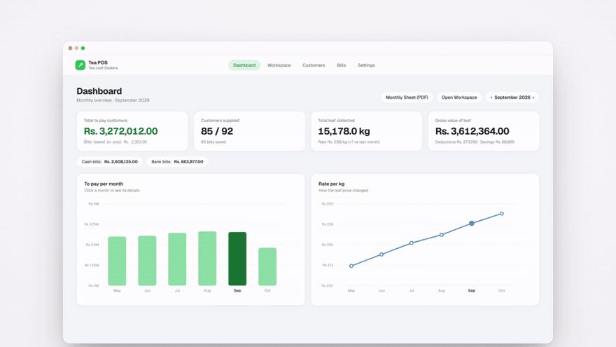
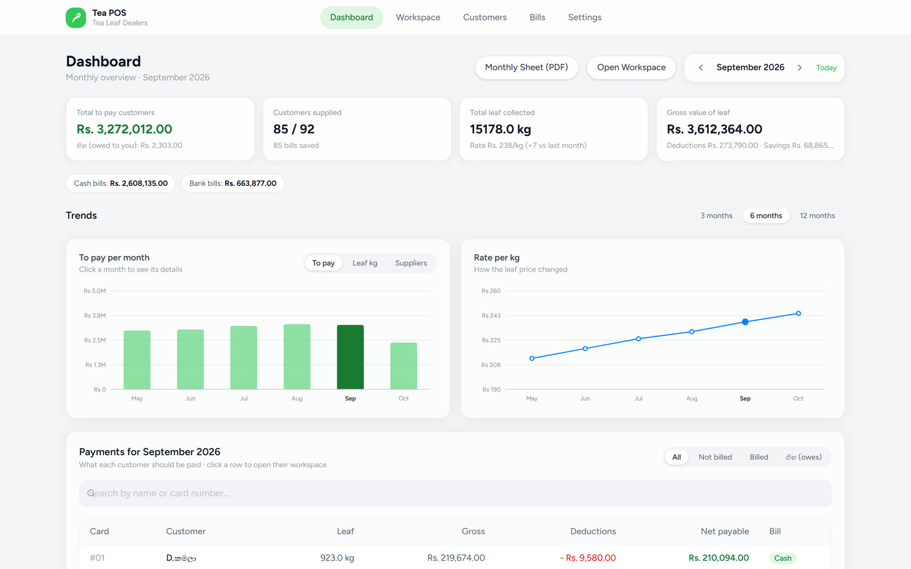
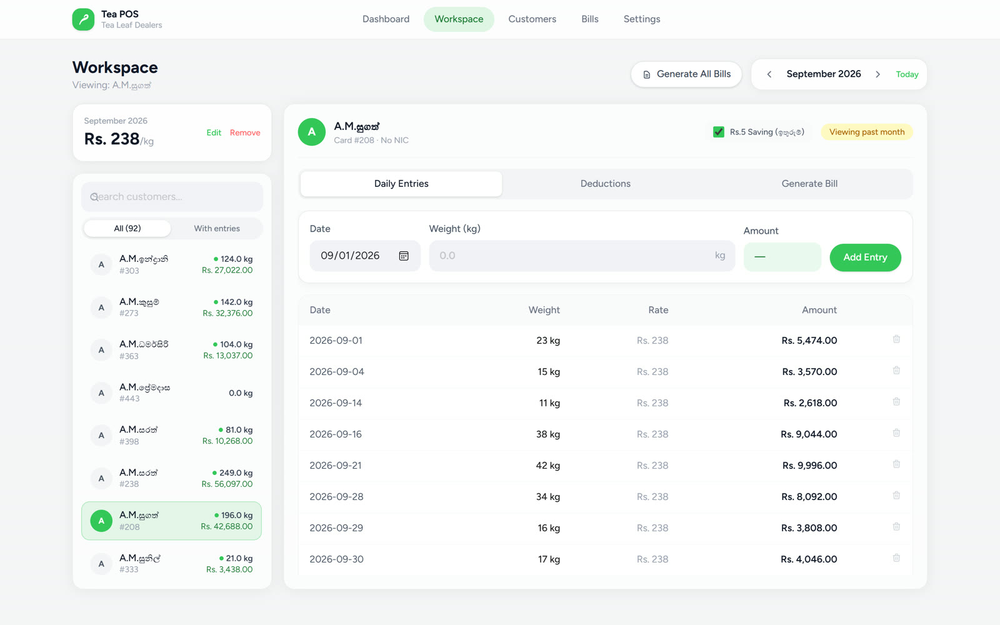
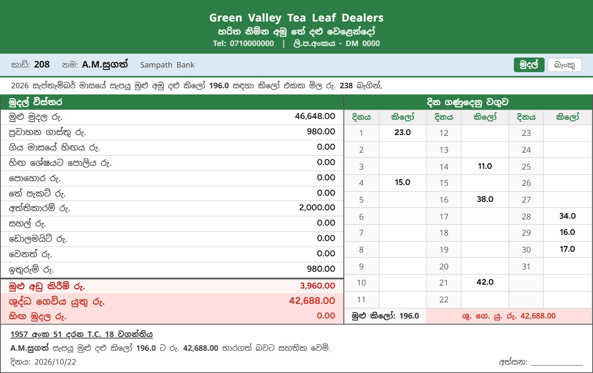
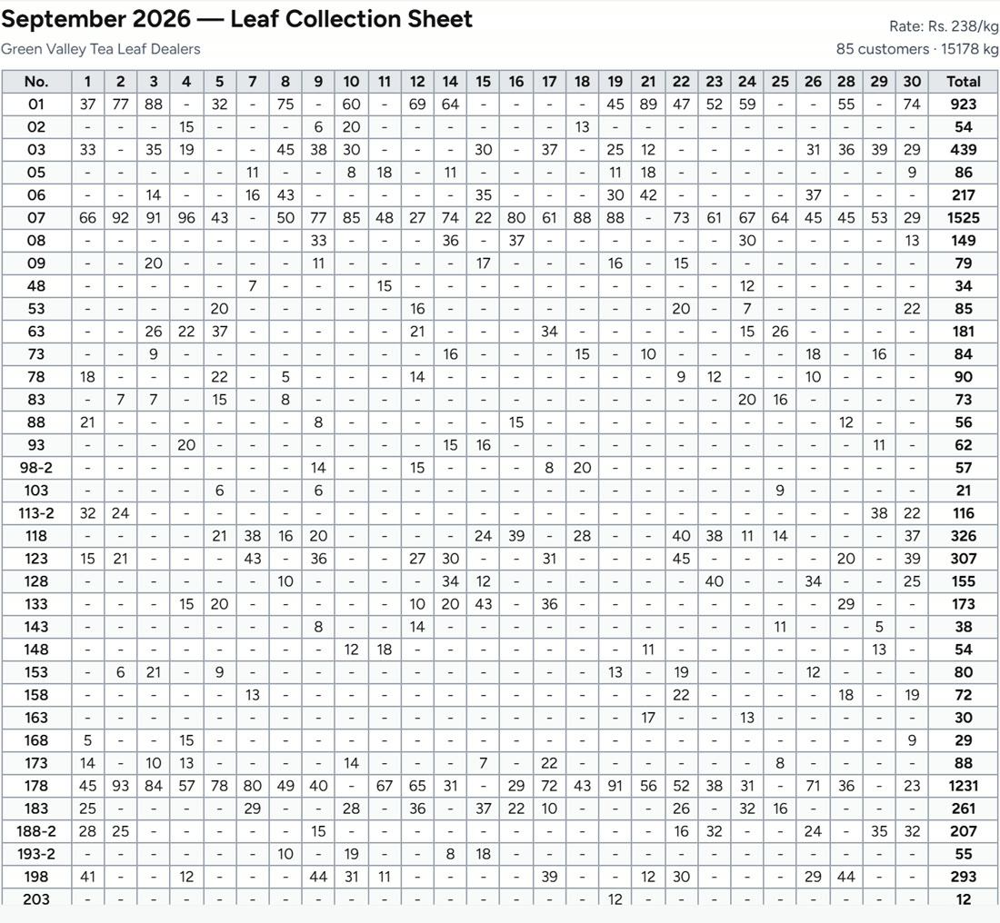
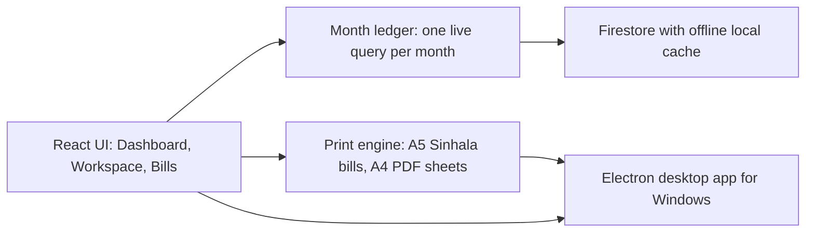

# 🍃 Tea POS

**Billing and management system for Sri Lankan tea leaf dealers**

Weigh-ins · deductions · Sinhala bills · monthly books, all in one desktop app.

▶ **[Watch the 30-second product film](media/tea-pos-product-film.mp4)**

> [!NOTE]
> This is a **showcase repository**: it presents the product, not its source code. Tea POS is proprietary software
> running in production for a tea leaf dealership in Sri Lanka. All screens below use **fictional demo data**.

---

## The problem

Tea leaf dealers buy leaf from dozens of small growers every day. Traditionally everything lives in a paper book:
every weigh-in, every advance, fertilizer and transport deduction, and at month end, a hand-written bill for each grower.
It takes days, mistakes are expensive, and nobody can see the month at a glance.

## What Tea POS does

| | |
|---|---|
| **📊 Live monthly dashboard** | Total to pay, growers supplied, leaf collected and gross value for any month, with 3, 6 and 12-month trends of payouts and the price per kg. |
| **🔎 Instant search** | Find any grower by name (Sinhala or English) or card number in a keystroke. |
| **⚖️ Fast daily entry** | Enter today's weight and the amount, the grower's total and the month's totals update instantly. |
| **🧾 Sinhala bills, auto-saved** | A5 bills in Sinhala with every deduction, savings and a day-by-day weight grid. Saved the moment they're previewed, so nothing printed is ever lost. |
| **💸 Deductions that think** | Transport, advances, rice, dolomite, tea packets, previous balance and interest, plus fertilizer split automatically into 3 monthly installments. |
| **🐷 Grower savings** | Per-kg savings per grower, with history and payouts. |
| **📒 The book, printed** | A one-click A4 PDF of the month's collection sheet: card numbers × collection days, exactly like the paper book. |
| **💳 Who owes whom** | Net payable per grower, cash vs bank totals, and outstanding balances (හිඟ) flagged automatically. |
| **🛟 Backup & restore** | Full JSON backup and restore of all data. |

## Screens

<table>
<tr>
<td width="50%"> <b>Dashboard:</b> the whole month at a glance.</td>
<td width="50%"> <b>Workspace:</b> every grower's kilos and payable, side by side with their daily entries.</td>
</tr>
<tr>
<td width="50%"> <b>Sinhala A5 bill:</b> deductions, savings and the daily weight grid.</td>
<td width="50%"> <b>Monthly sheet:</b> the paper book, generated as an A4 PDF.</td>
</tr>
</table>

## How it's built

- **Frontend:** React 19, Vite, Tailwind CSS v4, React Router
- **Data:** Firebase Firestore with a persistent local cache, so it keeps working without internet
- **Desktop:** Electron, packaged as a Windows installer, with native printing and PDF export
- **Printing:** pixel-exact A5 bills and A4 sheets, with Sinhala typography (Noto Sans Sinhala)
- **Design:** a clean, Apple-inspired interface built for fast keyboard use at the weighing counter

### Engineering highlights

- **One query per month instead of one per grower:** the whole month's entries, deductions and bills load once, so every grower's kilos and payable show instantly and switching growers needs no extra loading.
- **Bills can't silently go stale:** if entries change after a bill was saved, the dashboard flags it as *Changed since bill*.
- **Verified against real books:** the dashboard's calculation reproduces saved bills to the cent.
- **Safe restores:** batched writes stay within Firestore's limits and timestamps are restored correctly.

---

**Want a system like this for your business?**
Built by **[@tehan11109](https://github.com/tehan11109)**. We build systems that run your business, end to end.

© 2026 tehan11109. All rights reserved. See <a href="NOTICE.md">NOTICE</a>.

